# InferOptLab 项目架构 v0.1

日期：2026-11-20。状态：设计提案，所有模块支持范围以实际实现和真机验收为准。

## 1. 定位与边界

InferOptLab 负责把端到端优化组织成可复现的实验过程。输入是模型、硬件、推理框架、工作负载、优化目标及变更边界；输出是候选配置/代码、可追溯证据、验收结论、推荐部署和复现包。

首期围绕文本自回归推理，支持通过 ModelAdapter 表达 Dense、MoE、MLA、稀疏注意力和混合状态模型。多模态、会话、冷启动、应用依赖与动态伸缩采用条件扩展。训练优化不属于本项目首期范围。

项目不以“通信、内存、算子”作为封闭的顶层分类。它同时研究：哪些工作执行得慢，哪些工作可以复用或减少，哪些依赖、排队或放置方式导致等待。配置、实现、复用、调度、精度、生成策略、部署拓扑、输入处理、状态转移与框架版本均可成为候选变更，前提是满足冻结的语义和质量约束。

## 2. 推荐架构：模块化控制端与执行 Worker

第一版采用一个 Python 仓库和一个控制进程。GPU 执行进程与控制进程分开，最初可以在同一台机器，也可通过 SSH/容器执行器放在已有服务器。控制端使用 SQLite 存元数据、本地目录存制品；远程 Worker 的元数据统一交回控制端，不能各自在共享文件系统上并发修改同一个 SQLite 文件。

后续多用户、多机并行时，将元数据仓储替换为 PostgreSQL，将制品存储替换为 S3 兼容对象存储，并可增加 API 服务和集中队列。领域对象、优化器接口及验收规则不随存储替换而改变。

```mermaid
flowchart TD
    S["StudySpec：模型、资源、负载、约束"] --> O["实验总控：状态、预算、资源预约"]
    O --> M["测量与诊断"]
    M --> P["优化计划与候选搜索"]
    P --> C["配置优化执行器"]
    P --> I["代码优化执行器：KDA 等"]
    C --> V["独立验收与组合集成"]
    I --> V
    V -->|继续实验| M
    V -->|通过| R["推荐方案与复现证据"]
```

图中每次实际构建、运行、测量均由 Worker 执行；设备、框架、模型、profiling 与外部工具适配器位于 Worker 或独立子进程边界。实验元数据与制品是所有模块共享的证据底座。

## 3. 两类优化闭环，共用一个验收体系

### 3.1 系统配置闭环

在已支持的实现中选择部署模式、设备放置、并行布局、调度预算、批处理、缓存策略、通信后端、算子后端、精度和生成选项。首先做合法性与能力过滤，再做有限枚举、分层搜索或性能模型预筛；最后在真机验证。

聚合部署和 P/D 分离必须从同一层进入搜索。一个候选是完整 DeploymentSpec，而非孤立的 TP 或 batch 数值。P/D 候选同时表达 P/D 各自的进程和设备映射、KV 数据格式、传输后端和兼容性证据。

### 3.2 实现优化闭环

针对已确认或有待验证的机制问题，生成算子、融合、数据布局、通信编排、状态生命周期、调度器或其他框架运行时代码的改动。输出不可变候选包，再独立构建、检查正确性、局部评测和端到端验证。

KDA 是 CodeOptimizationBackend 的一个可选实现。当前官方公开主体是工作流、提示模板与技能约定；本项目需要实现自己的适配层，而不能假设存在稳定的 KDA SDK。[S1]

### 3.3 两类闭环的耦合

更快的 kernel 可能改变最佳 batch；缓存节省可能改变最大并发；通信优化可能改变最佳并行布局。因此每个有效实现分支都需要先做固定工作点 A/B，再在相同预算内重新搜索运行点。固定点收益和重新寻优收益分别报告。

组合变更生成一个新的 CandidateSpec，记录所有父候选与冲突关系。单项收益不相加；组合需要重新验收。若没有合格候选，输出“当前预算下无合格方案”及限制证据。

## 4. 模块与边界

| 模块 | 核心职责 | 输入 | 输出 |
|---|---|---|---|
| `domain` | 版本化对象、单位、状态、领域不变量 | 原始配置与适配器结果 | 严格类型对象 |
| `application` | 编排用户用例，串联各模块 | StudySpec、操作请求 | 任务与报告引用 |
| `orchestrator` | 状态机、预算、预约、恢复、取消、重试 | 任务 DAG、资源池 | WorkerJob、状态事件 |
| `inventory` | 环境探测与能力验证 | 目标节点、镜像、模型 | EnvironmentSnapshot、CapabilityReport |
| `measurement` | 负载回放、基准、校准、trace、指标归一化 | TrialSpec、DeploymentSpec | MeasurementBundle |
| `diagnosis` | 可比性检查、异常、假设、区分实验 | 证据、基线、经验参考 | Hypothesis、未解释问题 |
| `search` | 条件候选空间、剪枝、策略、预算分配 | 目标、能力、机制库 | CandidateSpec、TrialSpec |
| `optimizers` | 配置修改或代码优化任务执行 | OptimizationTask | CandidateBundle |
| `validation` | 独立正确性、SLO、统计、回归、集成判定 | 候选包、独立测量 | AcceptanceReport |
| `registry` | 元数据、对象血缘、制品、事件记录 | 所有结构化结果 | 可查询历史与复现包 |
| `reporting` | 报告、证据链接、推荐范围 | 验收后的记录 | Markdown/HTML/JSON |
| `adapters` | 平台、框架、模型、工具、执行环境接入 | 内部标准对象 | 外部命令/原始结果及能力证据 |

`domain` 不导入 CUDA、CANN、ROCm、SGLang、vLLM 或特定 Agent 的 Python 包。厂商依赖在适配器环境中安装。控制端不要求 PyTorch，也不要求拥有 GPU。

## 5. 优化方向通过机制库开放扩展

每张 MechanismCard 声明以下内容：问题信号、可替代解释、必需证据、适用模型/硬件能力、实验方式、允许变更、预期影响、正确性条件、冲突机制、回退方式。

起始标签可包含 `compute`、`memory`、`communication`、`scheduling`、`reuse`、`generation`、`precision`、`placement`、`host`、`startup`、`application`，标签只是检索入口。一个机制可以同时带多个标签，未注册的标签也不应导致任务被丢弃。

例如“Prefill 太慢”可以来自 GEMM 低效、重复计算、CPU 分词、排队、分块过细、缓存没有命中、数据搬运或跨 rank 等待。系统应保存多个解释，安排能区分它们的实验，而非直接输出“优化算子”。

没有合适机制时生成 `UnexplainedIssue`，包含缺失观测、可能原因和下一项测量建议。允许工程师或 Agent 提交新机制，版本化登记后进入统一验收流程。

## 6. 状态机和恢复策略

### 6.1 Study 状态

`draft → validated → baselining → diagnosing → optimizing → integrating → completed`

阶段允许循环。`paused`、`cancelled`、`budget_exhausted` 是独立终态/暂停原因，不能与优化成功混淆。

### 6.2 Run 状态

`created → scheduled → preparing → running → collecting → succeeded`

失败原因另存枚举：`unsupported`、`infeasible`、`build_failed`、`startup_failed`、`oom`、`timeout`、`cancelled`、`measurement_invalid`、`infra_error`。SLO 不达标属于有效测量后的验收失败，不是基础设施异常。

代码候选另外维护验证阶段：`proposed → built → correctness_passed → local_measured → e2e_measured → accepted/rejected/inconclusive`。Agent 自报结果不能推进独立验证阶段。

### 6.3 预约、幂等与断点续跑

- 每个 GPU 实验获取带 TTL、心跳和 fencing token 的 ResourceLease；所有 Worker 必须校验 token。控制端重启后先核对存活进程，再释放或恢复预约。
- 预约粒度可以是设备、节点、NIC 和共享链路组。独占 GPU 但共享网络的通信实验仍可能相互干扰，需单独声明干扰域。
- 幂等键覆盖候选指纹、Trial、重复编号、环境与测量协议；`attempt_id` 标识基础设施重试。统计重复必须使用独立的 `replicate_index`。
- SQLite 事务与外部任务不能假设实现恰好一次执行。用任务令牌、Worker 心跳和进程核对处理至少一次投递；避免重启控制端后重复启动同一实验。
- 完整候选和测试协议使用不可变快照，制品先写临时位置再原子登记。重试保留原失败记录，不覆盖。
- 只自动重试事先规定的基础设施错误。OOM、不满足质量与 SLO 不能通过反复重试被“刷成成功”。

## 7. 数据底座

元数据初版建议使用 SQLite 单写者；大 trace、日志、请求样本和构建产物放制品目录。结构化请求和计数器数据可使用 JSONL 起步，在数据量需要时增加 Parquet。所有制品带 SHA-256、大小、生成工具版本和所属 Run。

建议的元数据集合：

`studies`、`environments`、`workloads`、`candidates`、`candidate_parents`、`trials`、`runs`、`measurements`、`hypotheses`、`artifacts`、`acceptance_reports`、`leases`、`events`。

外部框架升级、模型 revision 改变、数据集/分词器变更或评分定义变更，必须产生新的快照。比较规则明确哪些变化属于实验自变量，其他差异阻止直接排名。

必须区分四类证据：`measured` 真机独立测量、`predicted` 性能模型预测、`agent_claimed` Agent 自报、`derived` 从已有证据计算。派生值保存公式和来源，不冒充独立测量。

## 8. 决策边界

| 决策 | 主要负责人 | 原因 |
|---|---|---|
| 环境与配置是否合法 | 确定性验证器 + 适配器能力报告 | 不能凭自然语言猜测支持 |
| 是否存在瓶颈及下一步测量 | 规则、统计和 LLM 辅助 | 需要证据与可证伪假设 |
| 应尝试什么配置/代码 | 搜索器、工程师、Agent | 允许多种候选生成方式 |
| 测量是否有效 | 测量质量检查器 | 要识别负载不足、污染、丢样和 profiler 干扰 |
| 是否通过最终验收 | 独立验收器 | 固定评测口径与质量标准 |
| 是否在外部发布/上线 | 项目约定的发布流程 | 性能实验通过不自动等于生产部署 |

LLM 在架构中属于可替换的推理与候选生成组件。没有 LLM 时仍应能执行基准、枚举配置、验证补丁和生成报告。

## 9. 首版技术选择

下表是本项目建议，具体依赖版本由开发时的锁文件固定。

| 领域 | v0.1 建议 | 后续扩展条件 |
|---|---|---|
| 主语言 | Python 3.11+；外部工具使用隔离环境 | 性能热点再考虑 Rust/C++ |
| 数据契约 | 先冻结 JSON Schema；运行时绑定与契约测试保持一致 | API 扩展保持向后兼容 |
| CLI | 标准 CLI 框架，如 Typer；不依赖 Web 才能运行 | 多用户时增加 HTTP API |
| 编排 | 持久化状态机 + 单写者任务调度 | 多控制端时增加集中队列/事务协调 |
| Worker | 本地子进程，随后 SSH/容器执行 | 已有集群需求再接 Kubernetes |
| 存储 | SQLite + 制品目录 | 多用户/多节点时 PostgreSQL + 对象存储 |
| 搜索 | 能力剪枝 + 小规模条件枚举 + 分层预算 | 实验积累后增加贝叶斯/多保真搜索 |
| 性能预测 | 插件化、可选 | 仅在匹配的测量覆盖范围内辅助排序 |
| 报告 | JSON + Markdown/HTML | 后续界面复用相同数据 API |

不将任一厂商 SDK、KDA、Dynamo 或 AISim 设为核心必需依赖。AISim 可用于离线预测和配置候选排序；AIConfigurator 当前处于迁移维护阶段，具体包名与安装版本需要锁定。[S4][S5]

## 10. 首版闭环及交付范围

先选择一个已经稳定可运行的平台、一个框架版本、一个固定模型和两类负载。若有合适 NVIDIA 测试机，可先验证 KDA 原生链路；若先用 BW1000，则先打通数据和实验闭环，代码优化执行器支持工程师回传或目标平台适配后的 Agent。两种路径复用同一核心架构。

首版完成条件：一个 Study 可以从环境冻结开始，完成 B0/B1、配置比较、一个解释充分的瓶颈任务、代码候选导出/导入、独立验收、组合复测和完整报告。可用的平台能力决定哪些候选可执行；不可执行的 P/D 或优化机制仍保留原因，报告不得将部分覆盖表述成完整搜索。

## 来源

外部项目事实见 [sources.md](sources.md)。本文件中的模块、接口、状态机、数据库和目录是 InferOptLab 的建议设计，不是现成软件已具备的能力。
