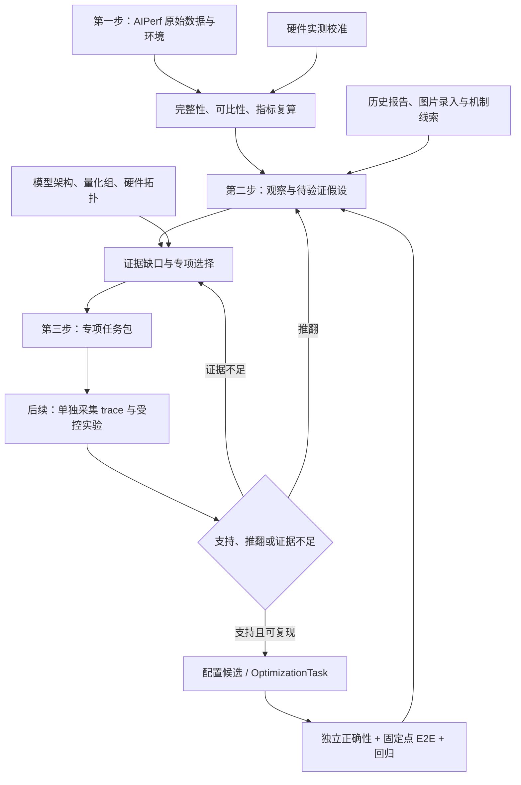

# 第二步归因与第三步专项分析：首版设计及实现

这版把已经跑通的 benchmark 接到离线归因，再接到详细专项任务。已有实测用于验证输入和计算，历史技术报告用于提出研究方向。真正的 kernel 根因确认需要后续 trace 和对照实验，本版不生成虚假的热点或性能结论。

## 1. 三步各自回答的问题

| 阶段 | 要回答的问题 | 输入 | 输出 | 当前可运行范围 |
|---|---|---|---|---|
| 第一步 benchmark | 这个模型/部署/负载跑得怎样 | Model/Hardware/Runtime/Workload/Protocol/Deployment | 原始请求、环境、统计、SLA 和日志 | 已在原 metax 单卡 Qwen 跑通 |
| 第二步 diagnosis | 哪些现象值得调查，现有证据支持到哪里 | 已封存 benchmark、硬件校准、来源数据 | 描述性比较、假设、替代解释、缺失证据、未解释问题 | 已实现并读取真实 Qwen 归档 |
| 第三步 analysis | 怎样把假设验证到具体模块和可改位置 | 归因报告或已检查的模型/硬件、方法卡、预算 | 专项任务、采集字段、控制实验、证伪条件、交接要求 | 已实现任务规划及归一化 trace 离线汇总 |

第三步完成后才进入配置/代码候选、独立验收和组合重调。配置搜索可与归因循环进行，不强制所有问题走代码优化。



图中的 trace 执行、受控 GPU 实验和优化器不是本版新实现的自动动作。当前 CLI 没有远端执行路径。

## 2. 目录和依赖

```text
diagnosis/
  contracts.py       # 新对象的语义与摘要校验
  evidence.py        # 封存、快照、请求集、原始指标核对
  engine.py          # 比较与假设规则
  report.py          # 人类报告
  cli.py             # seal / plan / run
  plans/qwen-metax.yaml
analysis/
  planner.py         # 假设到专项任务，适用性和预算
  trace.py           # clock/rank 内重叠区间汇总
  cli.py             # plan / trace
  plans/             # Qwen 与三种 GLM
  examples/overlap.yaml
schemas/
  definitions/       # 新增七种对象
  templates/diagnosis/plan.yaml
  templates/analysis/{plan,method}.yaml
  recipes/analysis/  # 十一种详细方法
runs/
  diagnosis/         # 归因结果，独占创建不覆盖
  analysis/          # 专项任务与 trace 汇总
```

依赖方向是 `benchmark 归档 → diagnosis → analysis`；前两步不会依赖厂商 Python SDK。共享基础对象仍由 `schemas` 管理，不在阶段目录另建私有 Model/Hardware。`analysis.trace` 只消费显式归一化格式，保留未来 ProfilerAdapter 的转换边界。

## 3. 新增七类规约

| 对象 | 定义文件 | 核心不变量 |
|---|---|---|
| DiagnosisPlan | `diagnosis-plan.json` | 输入批次与清单摘要固定，历史材料不得当因果实测 |
| DiagnosisReport | `diagnosis-report.json` | 输入可追溯，失败可见，观察不自动晋升根因，报告带摘要 |
| AnalysisMethod | `analysis-method.json` | 每个方法都要有替代解释、采集字段、控制实验与证伪条件 |
| AnalysisPlan | `analysis-plan.json` | 目标模型/硬件/runtime 明确，归因作用域一致，预算有限 |
| AnalysisReport | `analysis-report.json` | 方法和上下文快照固定，任务状态明确，未执行结果为 null |
| TraceCapture | `trace-capture.json` | 单位、窗口、时钟域、rank、事件身份明确，禁止越界事件 |
| TraceSummary | `trace-summary.json` | 重叠使用 union，跨 rank 不求总延迟，关键路径未证明就为空 |

沿用 `schema_version: 0.2.0` 的增量扩展。旧 `MechanismCard 0.1` 与 `OptimizationTask 0.1` 不改写，以免破坏原有例子；新 AnalysisMethod 是可版本化、可展开的专项实验规约。冗余物化方法明确承接旧机制卡，未来可建立完整机制—方法的多对多注册，不要求一张机制卡只能对应一个专项。

定义使用 JSON Schema；模板、计划、配方与结果默认 YAML。命名由目录说明用途，不增加 `.schema`、`.template` 后缀。

## 4. 第二步的方法边界

先问“数据能不能用于该比较”，再问“可能发生了什么”。

| 检查层 | 必须核对 | 处理 |
|---|---|---|
| 完整性 | manifest、原始导出、快照、数据集摘要 | 不符即拒绝分析 |
| 身份 | Study 内容、trial、run、case、deployment、协议 | 防止错批次、错模型和历史配置冒充当前 |
| 数值 | 请求级计数、实际 token、TTFT/TPOT、吞吐复算 | 原始数值与摘要不符即拒绝 |
| 有效性 | 失败、缺失、取消、环境验证、必要遥测 | 保留记录并排除不合格 run |
| 可比性 | 自变量之外的模型、硬件、运行库、协议、输出、cache | 进入不同分组，不能给收益比 |
| 充分性 | 独立重复与单点请求数 | 不满足时只能观察，不能验收 |
| 因果性 | 阶段/算子 trace、关键路径与单因素干预 | 缺失时只输出假设 |

封存摘要和报告摘要用于检测修改及保持血缘，不是第三方真实性认证。用户或外部工具声明的测量类型仍需真实执行证据支撑。

首版规则不是封闭问题分类。未命中规则仍记录 `unexplained`，新方法可通过 YAML 注册。将来可加入 LLM 辅助解释，但生成的解释必须遵守同样的证据与证伪要求。

## 5. 第三步的统一实验流程

每个专项按同一过程进行，方法卡再细化平台和模型差异：

1. **确认作用域**：模型精确变体、权重格式、真实加载布局、服务源码/镜像、设备映射、测试场景、对应 Run。
2. **补齐无 profiler 控制**：小样本资格运行不能承担正式收益结论，先确认稳定性、重复和代表性。
3. **最小采集**：只采能区分候选解释的 trace/计数器，隔离启动、编译和预热，控制 profiler 干扰。
4. **还原边界与工作量**：请求、step、layer、operator、kernel、rank 关联；CPU/设备/多节点时间不可随意相减。
5. **选择匹配参考**：优先同硬件/runtime/dtype/shape/layout 的校准，缺失则新增测量任务；纸面峰值仅是规格资料。
6. **执行最小干预**：一次改变一个机制，记录不变项、支持条件和推翻条件。
7. **独立正确性与局部验证**：数值、状态、别名、mask、路由、边界、fallback；不接受只报速度。
8. **回接 E2E**：局部收益不自动等于全局收益，必须固定工作点复测；重新寻优和组合收益分别记录。
9. **形成结论**：支持、推翻、证据不足均是有效结果；不能删除失败路径。

当前规划器只完成以上步骤的输入组织、预算与任务展开；第 3、6、7、8 项的真实执行仍是后续接入重点。

## 6. 已有资料如何进入本版

| 已有材料 | 已复用信息 | 用途 | 保留的限制 |
|---|---|---|---|
| Qwen 真机 AIPerf 归档 | 4 个 run、16 个测量请求、配置与设备身份 | 第二步可运行示例、指标复算、第三步作用域 | 单点仅 4 请求，非正式 SLA 与根因证据 |
| C500 GPU0 硬件微基准 | 4096³ FP16/BF16/FP32 GEMM、256 MiB device copy | GEMM 和内存方法的匹配基准入口 | 仅对应设备与校准运行库，不能填给新集群 |
| MetaX GEMM 实验 README | naive/tiled/寄存器分块/MMA、mcProfiler 线索 | 形状相关优化路径和采集检查项 | 来源已有实验不等于本项目重新验证了 profiler |
| DeepSeek/BW1000 项目记录 | RLC、AllGather/ReduceScatter、padding、小算子、GEMM、MTP | 通信、冗余物化、Compressor、生成方法设计 | 历史平台/版本/口径不同，收益不迁移不相加 |
| GLM Prefill 表格与 Decode 图片录入 | 长度、并行布局、FP8/INT8/INT4、报告口径 | 场景覆盖与量化/注意力方法线索 | fakePrefill 与 E2E 不混比，裁切和缺失继续保留 |
| BW1000 清程技术报告录入 | Prefill/Decode 与合同结果、质量结果 | 验收口径和历史 reference | 来源陈述与独立实测分开；矛盾没有替用户定论 |
| 三种 GLM 实际 config/header | 层数、专家、注意力、量化分组、权重大小 | 生成具体不同的专项作用域 | 文件存在不等于 loader 可用；未测 GLM 性能 |
| 新四节点硬件清单 | 设备序列号、NUMA、PCIe、驱动、占用状态 | 集群任务资源前置条件 | 链路属性不等于带宽/通信实测，历史占用需重新检查 |

历史资料以 `schemas/recipes/observations/` 的结构化录入和相应 SourceDocument 为入口。原始 V1/V2 文档或图片不在本地时，沿用已有录入与设计文档，并明确缺失原件；本版没有重新读取不存在的附件。

现有硬件校准可提供的具体参考：4096³ FP16 约 225.22 TFLOPS、BF16 约 225.07 TFLOPS、FP32 约 29.30 TFLOPS，256 MiB 设备内复制按读写两倍 payload 口径约 1373.70 GB/s。这些值全部来自 `metax-hardware-baseline-metax-gpu0-measurement@1.0.0`，不代表量化 MoE、小 M decode GEMM 或跨卡通信的能力。

DeepSeek 历史 C4 3.34→1.6 ms、通信约节省 300 μs、padding 约 200 μs，只说明值得检查的机制；“T7FT +4%”“TPOT +7%”等未统一方向/定义的陈述继续保留原口径，不转成确定 E2E 加速比。合同表与测试附件的 cache 规则冲突也不在归因阶段擅自消解。

## 7. 当前生成的结果

第二步读取真实归档，得到 4 个有效观察 run、2 组单变量比较、2 个待验证假设：长输入 TTFT 增长相关假设，以及服务端/设备阶段边界缺失。不存在自动确认的 kernel 瓶颈。

第三步为 Qwen 展开 11 项方法，其中 7 项待采集，4 项因单卡/dense/无量化/无 draft 不适用。每种 GLM 各生成 11 项基线前任务，引用其自身架构与量化配置。完整 W8A8 保留单节点容量问题。

| 结果 | 位置 |
|---|---|
| Qwen 归因报告 | `runs/diagnosis/qwen-metax-v1/report.md` |
| Qwen 专项任务 | `runs/analysis/qwen-metax-v2/report.md` |
| GLM Flash-W8A8 任务 | `runs/analysis/glm53-flash-v1/report.md` |
| GLM W4A8 任务 | `runs/analysis/glm53-w4a8-v1/report.md` |
| GLM W8A8 任务 | `runs/analysis/glm53-w8a8-v1/report.md` |
| 合成重叠 trace 汇总 | `runs/analysis/overlap-summary.yaml` |

所有这些结果均为离线处理，本次没有在任何机器启动新 GPU 工作。

## 8. 下一轮实施的具体切口

优先接 **request-timing + scheduling-graphs**：沿用原 metax 的 Qwen 服务，先补无 profiler 重复控制，再实现一个经过资格检查的框架 trace 采集器，拿到 request/step/layer/kernel 的最小关联。之后按真实热点选择 GEMM、attention 或物化专项，避免在没有形状和调用点时直接写 kernel 优化任务。

| 待实现模块 | 输入/输出 | 完成标准 |
|---|---|---|
| ProfilerAdapter 能力探测 | 目标 Runtime → 工具版本/权限/支持范围 | 真机识别可用采集功能，失败保持 unverified |
| ProfileJob 执行与资源租约 | 专项任务 → 原始 trace/日志 | 独占与取消清理、预算、失联恢复、同负载控制 |
| 原生格式转换器 | 固定版本原始 trace → TraceCapture/关联表 | 时间单位、rank、关联 ID、丢事件和边界可核对 |
| 请求/算子依赖图 | 关联表 → 关键路径及 residual | 不重复计时，跨时钟有依据，无法解释部分保留 |
| 匹配微基准派发 | 真实 shape/layout/dtype → HardwareMeasurement 扩展 | 参考条件匹配；不借用不相关峰值 |
| 实验结果裁决 | 对照组+干预组+正确性 → 支持/推翻/不足 | 正确性独立、重复充分、局部与 E2E 分开 |
| 优化任务导出 | 已验证热点与代码作用域 → OptimizationTask | 无占位调用点，冻结源码和回退，独立验收可执行 |

此工作流对应旧路线图 M1 的测量延伸及 M3 的证据诊断；不宣称已经完成 M3 真正的“至少一个问题被实验支持或推翻”，也未进入 M4 的自动代码优化验收。
