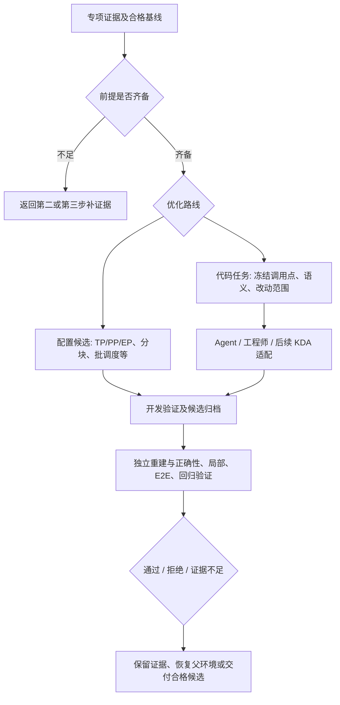

# 第四步：优化候选与验证交接

入口：`python -m optimization plan`。这一版能够读取第三步真实任务包，验证摘要、依赖和离线重放一致性，生成优化交接清单。尚未实现代码生成、参数搜索、GPU 执行或独立验收。

第四步回答：**有了专项证据之后，改什么、谁来改、怎样验证、失败怎样恢复？** 配置调整和代码优化是两条路线；配置搜索可以独立依据合格 E2E 基线开展，不要求每次都有 kernel 根因。当前入口仅承接第三步的计划对象。

## 运行与现有样本

在仓库根目录运行，复用 `schemas/requirements.txt`，没有额外 GPU 依赖：

```powershell
python -m optimization plan experiments/runs/analysis/qwen-metax-v2/analysis.yaml --out experiments/runs/optimization/qwen-metax-v1
python tools/specs.py validate experiments/runs/optimization/qwen-metax-v1/handoff.yaml
```

输出目录必须不存在；重跑时换一个目录，保留历史。输入路径相对当前目录解析；报告内部证据路径按项目根目录解析。已有第三步报告含绝对路径，迁移工作区后应先重建第二/三步结果，不应修改摘要绕过检查。

产物：`handoff.yaml` 为机器可读交接，`report.md` 为人工阅读入口。Qwen 的 7 个适用专项保持 `awaiting_evidence`，另 4 个保持 `not_applicable`；GLM 专项仍是 `awaiting_baseline`。`optimization_task`、`candidate` 和 `acceptance` 均为 null。

这不是可执行的 OptimizationTask。旧的 [OptimizationTask 契约](../schemas/definitions/optimization-task.json) 和 [示例](../examples/optimization-task.example.yaml) 保留，示例里的 `REPLACE_*` 不能作为真实值。新 [OptimizationHandoff 契约](../schemas/definitions/optimization-handoff.json) 只表达规划结果，不另建 Model/Hardware/Runtime 私有规约。

## 模块边界

| 模块 | 输入 → 输出 | 当前状态 |
|---|---|---|
| `handoff.py` | AnalysisReport → 已校验的缺口/交接要求 | 已实现离线重放、作用域继承和清单生成 |
| `cli.py` | 文件路径 → YAML/Markdown | 已实现，只写新输出目录 |
| `interfaces.py:TaskBuilder` | 已执行专项证据 + 冻结作用域 → OptimizationTask | 接口骨架；等待实验结果契约与实际调用点 |
| `interfaces.py:ConfigProposer` | 合格基线 + Study 搜索空间 → 配置候选 | 接口骨架；复用 DeploymentSpec，不另建部署体系 |
| `contracts/interfaces.py:CodeOptimizationBackend` | 任务 + 独立工作区 + 租约 → Agent 会话 | 既有接口；未实现 KDA/其他 Agent 调用 |
| `interfaces.py:CandidateCollector` | 代码/配置、开发记录 → 候选包 | 接口骨架；开发通过仍标 unverified |
| `interfaces.py:AcceptanceCoordinator` | 候选 + 锁定规则 → 独立验收报告 | 接口骨架；复用 IndependentValidator |
| `interfaces.py:RollbackExecutor` | 父候选 + 本任务拥有的资源 → 恢复记录 | 接口骨架；不操作其他服务 |

接口不是隔离机制。编辑范围、资源互斥、预算强制终止及验收器只读必须由后续执行层实现，不能只靠提示词宣称已满足。

## 目标工作流



当前 CLI 实现图中前提检查的**规划交接**。后续状态可设计为 `draft → ready → developing → unverified → validating → accepted/rejected/inconclusive`，并记录 `failed/cancelled/budget_exhausted`。这些执行状态尚未接入当前 schema，不能手动修改交接包把它升级成执行结果。

## 两条路线的任务内容

**配置路线**：记录父 DeploymentSpec、唯一变更维度、合法取值/约束、每个候选的完整有效配置、启动参数、设备及并行组映射。TP/PP/EP 乘积不直接代表设备数。先检查框架能力、容量和资源范围，再用相同请求集与协议测量。跨框架比较或精度变更须标明多变量变化；配置搜索后的最优点需要独立复测。

**代码路线**：记录源码仓库/commit/父补丁摘要、镜像和工具链、调用点及真实 shape/dtype/stride、语义/状态/aliasing、特化 guard、fallback、允许和禁止编辑路径。开发构建/正确性/计时入口用 argv 表达。独立验收器、隐藏数据、评分口径不在 Agent 的可编辑范围内。未冻结的源码和泛称的“优化 GEMM”都不够生成正式任务。

两条路线都必须有固定点 E2E、短/长场景覆盖、质量/SLA 规则、预算和恢复方法。先验证单项，再验证组合；单项收益不能相加。调参后的收益与保持原配置的补丁收益分开报告。

## 候选与验收的交接字段（后续契约）

| 对象 | 必须保存 |
|---|---|
| CandidateBundle | task/parent ID、基线与 patch/commit/hash 或完整配置、构建依赖、适用形状/精度、guard/fallback、开发原始日志、失败与预算消耗、dev_claims、validation_status=unverified |
| AcceptanceReport | 候选及验收器摘要、独立重建记录、正确性/质量、局部与 E2E 原始 Run 引用、可比性、重复与不确定性、SLA、回归、最终判定及原因 |
| 恢复记录 | 本任务创建的服务/容器/文件、父版本、恢复动作、恢复后的健康检查及未恢复事项 |

此表是字段设计要求，不是已注册的新 schema。当前没有伪造候选/验收示例；等第一个真实任务形成后再固化这两种契约与执行器。

## 预算、终止与机器约束

第三步的采集预算不覆盖第四步。第四步应分别指定最大候选数、GPU 秒、墙钟和 Agent token；编译、预热、失败、profiler 与独立验收都计入对应预算。数值缺失保持待填写，不沿用旧示例数值作为默认建议。

预算耗尽、资源身份变化或正确性失败时，停止当前候选的性能推进，保存状态并按已授权范围清理；不能无限重试、扩大卡数或改验收门槛。后续是否继续优化取决于剩余预算和用户任务范围。

本版只进行本地离线工作。项目目前约定：新四台 metax 节点用于信息核查，不停止已有 SGLang 服务；小模型流程使用原 metax，执行前重新核对设备和服务；GLM 正式性能测量仍需用户确认。这些是当前项目约束，用户后续明确调整时同步更新，不应变成所有集群的永久规则。

## 下一步实现顺序

1. 在第三步补真实 trace/控制实验结果及判定契约，冻结首个真实热点的调用点与输入。
2. 实现一个本地文件交接的 TaskBuilder 和候选收集器；先支持人工/Agent 提交，不假定外部 SDK 存在。
3. 实现独立工作区、资源租约、预算和停止/恢复，再接实际后端。
4. 锁定正确性与局部测试；最后回接原 benchmark 做固定点 E2E 与回归。

Agent 的阶段技能及简要约束见 [agent/README.md](../agent/README.md)。本目录覆盖第四步设计边界，不表示旧路线图 M4/M5 已验收。
