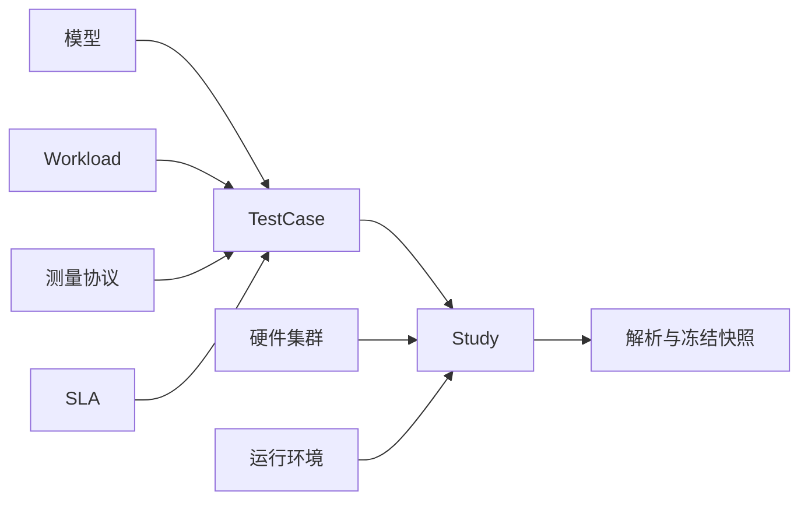

# 规约体系 v0.2.0

本目录只保存规约定义与标准创建模板。JSON Schema 是结构定义的唯一事实来源，YAML 是配方的编辑格式。实际配置统一在 [recipes/](../recipes/README.md)，参数示例在 `examples/parameters/`，证据、结果、索引与基线在 [experiments/](../experiments/README.md)。

第一阶段新增 [AccuracyPlan](definitions/accuracy.json)、[BreakdownPlan](definitions/breakdown.json)、[OperatorCase](definitions/operator-case.json)，对应 `accuracy/`、`breakdown/`、`operators/` 创建模板。[BenchmarkOfflineReport](definitions/benchmark-offline-report.json) 固定声明离线、未接纳，不与实测性能记录混用；[KnowledgeCollection](definitions/knowledge-collection.json) 定义资料库集合入口，具体集合登记在 `catalog/library/`。

第四步结果契约 [OptimizationHandoff](definitions/optimization-handoff.json) 由 `python -m optimization plan` 从第三步结果生成，放在 `experiments/runs/optimization/`。它记录待补证据、优化交接与回退要求，禁止填入未执行的候选/验收结果；OptimizationTask 则定义后续具体优化任务。详见 [第四步](../optimization/README.md)。

第二/三步新增 `DiagnosisPlan`、`DiagnosisReport`、`AnalysisMethod`、`AnalysisPlan`、`AnalysisReport`、`TraceCapture`、`TraceSummary`。定义在 `definitions/`，三类创建模板在 `templates/diagnosis/` 和 `templates/analysis/`，11 份方法配方在 `recipes/analysis/`。运行计划分别在 `recipes/plans/diagnosis/` 和 `recipes/plans/analysis/`，与 benchmark 计划一样纳入目录校验。生成报告放 `experiments/runs/`，不能登记为配方。使用与字段说明见 [阶段设计](../docs/diagnosis-analysis.md)。

新增机器使用 [硬件测试工具](../tools/hardware/README.md) 自动生成真实配方。[HardwareTestPlan](definitions/hardware-test.json) 定义测试计划；导出生成 `HardwareSpec`、`RuntimeSpec`、`HardwareMeasurement` 和 `SourceDocument`，保留逐卡样本及完整证据，而不是手填性能值。

实机入口：[C500 / GLM / DeepSeek 配方与实测说明](../recipes/README.md#metax-实机配方2026-11-23)。新增 `evidence_level: inspected` 后，模型必须包含 typed 架构、量化和 checkpoint 信息，集群必须包含逐卡探测信息；不能降为只有名称的记录。[inspected.json](definitions/inspected.json) 定义这些字段，[hardware-measurement.json](definitions/hardware-measurement.json) 保存带原始耗时的 `HardwareMeasurement`。字段要求按证据等级区分，实际记录须满足对应约束。

新增数据包括 `SourceDocument.authority: machine_collected`、集群 `discovery`、逐卡 `observed`、模型 `checkpoint`、结构化 MoE/混合注意力配置，以及 Runtime 的实际 `execution_profile`。原始机器证据放在仓库根目录的 `experiments/evidence/`；来源配方保留文件 SHA-256。`validate <配方> --sources` 同时检查该配方依赖闭包中的来源文件。

```text
schemas/
  definitions/                 # 字段与校验规则
    model.json
    hardware.json
    sla.json
  templates/                   # 创建模板
    models/model.yaml
    hardware/cluster.yaml
    slas/latency.yaml
  requirements.txt             # 规约工具依赖
  README.md
```

文件名按内容命名，由目录区分定义、模板和配方。创建方法见 [templates/README.md](templates/README.md)，来源数据清单见 [recipes/README.md](../recipes/README.md)。

目前实现了离线结构校验、跨配方语义校验、模板实例化、Study 解析及带内容哈希的快照冻结。[第一版 benchmark 模块](../benchmark/README.md) 已接入 AIPerf、单机 SGLang 部署、顺序实验编排和性能 SLA 计算。完整 GPU 能力资格测试与质量验收仍待接入；`validate` 通过或快照处于 `frozen` 状态，均不证明真机性能达标。

## 模型、硬件、SLA 三类核心规约

| 规约 | Schema | 模板 | 首版配方示例 |
|---|---|---|---|
| 模型 | [model.json](definitions/model.json) | [模型模板](templates/models/model.yaml) | [DeepSeek W8A8](../recipes/models/deepseek/deepseek-v4-flash/deepseek-v4-flash-w8a8.yaml)、[GLM INT8](../recipes/models/glm/glm-5.3-flash/glm-5.3-flash-int8.yaml) |
| 硬件设备 | [hardware.json](definitions/hardware.json) | [设备模板](templates/hardware/device.yaml) | [C500](../recipes/hardware/c500.yaml)、[BW1000](../recipes/hardware/bw1000.yaml) |
| 硬件集群 | 同上，`profile_type: cluster` | [集群模板](templates/hardware/cluster.yaml) | [BW1000 待确认资源](../recipes/hardware/bw1000-eight-card-budget.yaml) |
| SLA | [sla.json](definitions/sla.json) | [通用模板](templates/slas/sla.yaml)、[时延模板](templates/slas/latency.yaml) | [行业 64K/1K](../recipes/slas/industry-64k-1k.yaml)、[合同 Decode](../recipes/slas/deepseek-contract-5-decode.yaml) |

模型配方记录模型身份、权重与 tokenizer 指纹、架构、精度和验收策略引用。产品名、分支名、INT8 标签不能自动补齐 revision、量化算法或激活精度。

硬件设备配方记录产品规格；集群配方记录实际节点、唯一设备 ID、互联和能力声明。纸面 TFLOPS 不等于实测性能，TP/DP/EP 数值也不能相乘得到物理设备数。合同的“折合 8 卡”保存在 SLA 的归一化字段，首版集群的实际设备数仍为 `null`。

SLA 逐项规定指标、作用范围、统计量、比较符、阈值、单位、分母和归一化方式。平均 TTFT 与 p95 TTFT 是不同约束；来源给出的 `1–3s` 保存为未选定区间，不自动取 3s；未给比较符时保留 `unspecified`。

## 配套对象与组合

| 对象 | 文件 | 职责 |
|---|---|---|
| WorkloadSpec | [workload.json](definitions/workload.json) | 输入/输出长度、请求集、到达方式、负载点、缓存和生成规则 |
| MeasurementProtocol | [measurement-protocol.json](definitions/measurement-protocol.json) | Prefill/Decode/E2E 方法、计时边界、统计窗口、失败分母、重复与预热 |
| RuntimeSpec | [runtime.json](definitions/runtime.json) | 框架、源码 commit、镜像 digest、驱动、运行库和参数 |
| ValidationPolicy | [validation-policy.json](definitions/validation-policy.json) | 正确性/质量策略、验收器/数据集/参考结果指纹与检查规则 |
| TestCaseSpec | [test-case.json](definitions/test-case.json) | 组合模型、Workload、Protocol 和可选 SLA，保留业务优先级及原始 Case 标识 |
| StudySpec | [study.json](definitions/study.json) | 组合模型、集群、Runtime 和多个 Case，明确允许部署模式及预算 |
| SourceDocument | [source.json](definitions/source.json) | 原始文件相对路径、SHA-256、角色和录入覆盖范围 |
| ReportedMeasurements | [reported-measurements.json](definitions/reported-measurements.json) | 原资料报告的结果、原始平台标签、单位、缺失原因及提取范围 |
| RecipeTemplate | [template.json](definitions/template.json) | 有类型的参数及 `$param` 替换规则 |
| ResolvedStudy | [snapshot.json](definitions/snapshot.json) | 依赖闭包、文档内容哈希、冻结阻塞项及整个快照哈希 |
| DeploymentSpec | [deployment.json](definitions/deployment.json) | 模型/硬件/Runtime 引用、并行与调度、设备映射和服务管理方式 |
| BenchmarkScenario | [benchmark-scenario.json](definitions/benchmark-scenario.json) | 引用 Case 与固定请求集目录 |
| BenchmarkPlan | [benchmark.json](definitions/benchmark.json) | 场景/部署矩阵、AIPerf 版本、遥测、预算与执行顺序 |
| ResolvedBenchmark | [benchmark-snapshot.json](definitions/benchmark-snapshot.json) | 测试计划完整引用闭包、展开矩阵和计算出的阻塞项 |
| MeasurementBundle | [measurement.json](definitions/measurement.json) | 客户端统计、失败分母、有效性、原始结果指纹 |
| ExperimentRecord | [experiment-record.json](definitions/experiment-record.json) | 完整配方闭包、部署、命令、环境、结果与原始制品哈希的一一对应记录 |
| BaselineRecord | [baseline-record.json](definitions/baseline-record.json) | 不可覆盖的基线标签，精确引用实验记录及内容哈希；区分流程基线与正式性能基线 |



模型不绑定某一个硬件型号；SLA 不内嵌模型权重；负载不内嵌 SLA。同一个模型或工作负载可以被多个 Case 引用。相同输入/输出长度也可以对应不同合同条款，例如 DeepSeek 序号 7、8 必须保持独立。

## 使用

在仓库根目录运行：

```powershell
python -m pip install -r schemas/requirements.txt
python tools/specs.py validate --sources
python -m unittest discover -s tests -v
```

默认递归校验根目录 `recipes/` 的全部实际配方和 `schemas/templates/` 的模板，包含部署、场景和各阶段计划。`--sources` 额外核对原文件 SHA-256；Schema 引用只从本仓库解析，不访问远程 `$id`。

从模板创建一个新草案，参数文件中的 `id` 必须是新配方的全局唯一 ID：

```powershell
python tools/specs.py instantiate schemas/templates/models/model.yaml --params examples/parameters/models-model.yaml --out experiments/runs/specs/example-model.yaml
python tools/specs.py validate experiments/runs/specs/example-model.yaml --sources
```

确认字段和来源后将新配方放到相应 `recipes/` 子目录，再由 Case/Study 引用。第二次执行相同输出路径会失败，以免覆盖已有版本。

解析真实首版 Study：

```powershell
python tools/specs.py resolve recipes/studies/deepseek-bw1000-contract.yaml --out experiments/runs/specs/deepseek-bw1000.draft.json
python tools/specs.py validate experiments/runs/specs/deepseek-bw1000.draft.json --sources
```

`resolve` 允许未解决事项，输出 `state: draft` 及完整 `readiness_issues`。补齐输入、明确冲突并更新配方版本后，才使用：

```powershell
python tools/specs.py freeze recipes/studies/deepseek-bw1000-contract.yaml --out experiments/runs/specs/deepseek-bw1000.frozen.json
```

**首版真实 Study 的 `freeze` 应当失败。** 原材料没有提供完整的模型/镜像指纹、物理设备清单、请求集和实验预算，缓存约定也有冲突。失败不会写出伪造的冻结文件。测试中的完整冻结用例只使用内存里的合成数据。

## 校验边界

1. **结构校验**：必填项、类型、枚举和未知字段；未知业务字段必须进入有命名空间的 `extensions`，如 `source.platform_settings`。不允许 YAML 重复键或非有限数值。
2. **组合校验**：引用存在且类型正确、无循环依赖；物理设备唯一；Case 模型和允许部署模式一致；权重覆盖全部 Case 且总和为 1；单位、负载方式与指标口径一致。
3. **冻结检查**：消除阻塞事项、未选定 SLA 区间和占位符，检查必需指纹、计时规则、请求集及预算。单 token 输出不能计算 TPOT/ITL，缺少 token 时间戳不能宣称真实 ITL，fakePrefill 只允许诊断 Case。
4. **运行前检查**：规约 CLI 不执行配方命令。benchmark 执行器另行检查本地请求集/tokenizer 指纹、服务模型、端口、流式响应和服务配置回读，并记录设备探测结果。缺失或不符的环境证据标为未验证；完整精度/通信/质量资格测试仍需专门适配器。

`ReportedMeasurements.evidence_kind` 固定为 `source_reported`，并保留 `independently_reproduced: false`。历史截图的数字不会变成本平台测量结果；`null` 必须配套缺失原因，不能替换为 0。

## 版本与内容身份

- `schema_version: 0.2.0` 是规约语言版本；`version: 1.0.0` 是每份配方自身的版本。引用始终包含精确的 `{id, version}`，不支持 `latest` 或隐式覆盖继承。
- 已被实验引用的配方修改时创建新版本；可使用 `id.v1.1.0.yaml` 等文件名，解析器以内容中的 ID/版本为准。CLI 只保证输出不覆盖已有文件；直接手改的版本不可变性还需代码审查/后续制品库约束。
- 快照嵌入整个引用闭包。文档哈希基于 Python `json.dumps(sort_keys=True, separators=(",", ":"), ensure_ascii=False, allow_nan=False)` 的 UTF-8 字节；整体哈希排除自己的 `content_sha256` 字段。这是本版本的确定性编码约定，不声称实现 RFC 8785。
- 快照校验使用嵌入文档重新检查引用、文档哈希、整体哈希和阻塞项；不依赖后来变动的配方内容。`--sources` 仍要求原始来源文件存在且哈希匹配。

## 当前规约版本

规约工具只接受 `schema_version: 0.2.0`。[`study.json`](definitions/study.json) 直接定义引用组合式 Study；示例与实际配方使用同一版定义，不进行旧版分发或自动路径重定向。

`optimization-task.json`、`mechanism-card.json` 和对应示例统一到当前规约版本。Deployment、测试计划/快照和 MeasurementBundle 已有第一版定义；完整 Candidate 血缘、分布式 Run 调度和质量验收仍按 [数据契约设计](../docs/data-contracts.md) 后续实现。
